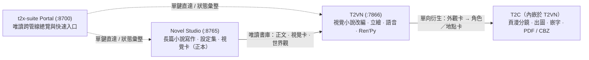

# t2x-suite

**從長篇小說寫作，到視覺小說（VN）與日式頁漫改編的一站式本機創作套件。**

`t2x-suite` 是統合 **Novel Studio** 與 **T2VN / T2C** 的極薄整合中樞：負責統一啟動服務、注入跨專案跳轉環境變數，並提供一個唯讀的 **Portal 總覽儀表板**，讓你在同一個畫面掌握每一部作品在「寫作 → 視覺小說 → 頁漫」三條管線上的即時進度。

> **設計原則**：各專案維持獨立開發、獨立虛擬環境與獨立啟動；不透過 `t2x-suite` 啟動時，跨工具入口會自動隱藏，對原專案零侵入。

---

---

## 組成專案介紹

### 1. Novel Studio（小說工作台）
- **定位**：本機長篇連載小說 AI 輔助寫作工作台（預設 `http://127.0.0.1:8765`）。
- **核心特色**：
  - **純文字資料所有權**：採用 v3 英文目錄標準（`bible/`、`outline/`、`manuscript/`、`candidates/`、`tracking/` + `book.json`），所有稿件與設定皆為本機 Markdown + YAML / JSON。
  - **三層寫作流程**：開書層（六步起寫）→ 卷層循環（排綱／寫作／卷末體檢／正文反推補設定）→ 收尾層（EPUB 3／TXT 匯出）。
  - **安全隔離與防錯**：AI 草稿一律先落 `candidates/`，人工確認定稿才進 `manuscript/` 並更新追蹤表；內建繁中用語護欄與覆寫前自動備份。
  - **結構化角色視覺卡**：`bible/visual-cards/` 同時相容漫畫規格與 VN 頭像／立繪／7 種表情分層，可直接作為下游改編的設定正本。
  - **多後端支援**：Claude Code、Google Gemini API、DeepSeek、llama.cpp 與 OpenAI 相容介面；內建插圖生成與 TagComplete 標籤補全。

### 2. T2VN（`text_2_visual_novel`，視覺小說改編工作台）
- **定位**：把小說文字轉成可遊玩的 Ren'Py 視覺小說遊戲（預設 `http://127.0.0.1:7866`）。
- **核心特色**：
  - **人在迴路的劇本管線**：從書庫（唯讀）或 TXT／MD／DOCX／EPUB 匯入 → 抽取章綱與角色表 → AI 標註分場／旁白／說話者／表情 → 瀏覽器左原文右劇本逐句校對。
  - **美術與聲音管線**：集中管理 ComfyUI 出圖 profile（Anima／MOSS-Image 與多條 LoRA）、角色外觀卡與自動去背、YuE2 配樂與環境音、以及 **sherpa-onnx** 固定聲線逐句配音（CPU 可跑）。
  - **輸出與自動驗收**：可先建立免安裝的 HTML 可玩原型，或匯出正式 Ren'Py 專案、執行自動化驗收與 Windows 發行打包。

### 3. T2C（`text2comics`，內嵌頁漫引擎）
- **定位**：以 `vendor/t2c` 整合進 T2VN 內的日式頁漫改編線（入口位於 T2VN 左側「漫畫」分頁）。
- **核心特色**：
  - **六分頁順向工作流**：專案 → 章節（切對話／改編規劃／劇本／分鏡）→ 分鏡唯讀看板 → 出圖（候選圖／補格／加畫）→ 嵌字（逐句對話框與狀聲詞微調）→ 頁面與輸出（右翻 PDF／CBZ／單頁 PNG ZIP）。
  - **與 VN 共用單一正本**：角色與地點設定以 T2VN 外觀卡（`t2c` 子物件）與 `style.json` 為正本，漫畫專案內的 `bible/*.md` 為純衍生物，隨時可重寫同步，避免兩邊設定脫節。

### 4. t2x-suite（本專案：統一啟動器與 Portal）
- **定位**：本機套件入口與唯讀跨管線儀表板（預設 `http://127.0.0.1:8700`）。
- **核心特色**：
  - **一鍵啟動與收尾**：自動拉起 Portal、Novel Studio 與 T2VN / T2C，偵測到埠號已在執行時自動略過；關閉視窗或按 `Ctrl+C` 一併結束所啟動的服務。
  - **唯讀總覽 Portal**：純 Python 標準函式庫實作、僅綁 `127.0.0.1`，即時顯示各服務（含 ComfyUI）在線狀態與全書跨管線進度，提供單鍵直達寫作／視覺卡／VN／外觀／漫畫／匯入。

---

## 跨專案連動功能

透過 `t2x-suite` 啟動時，兩邊會自動開啟以下連動（單獨啟動各自專案時自動隱藏）：

1. **雙向快速跳轉與深連結**：
   - Novel Studio 頂列顯示 `Portal ↗` 與 `T2VN / T2C ↗`；在特定書頁點擊會自動帶入來源書識別，已匯入直接開啟該書、未匯入自動帶出匯入視窗。
   - T2VN 頂列顯示 `Portal ↗` 與 `Novel Studio ↗`。
2. **視覺卡與世界觀單向同步（含漫畫連動）**：
   - T2VN 可一鍵從 Novel Studio 書庫唯讀同步 `bible/visual-cards/*.md` 與世界觀地點，並自動對該書既有的漫畫專案重跑 `bible_cards` 同步更新角色／地點卡。
3. **新章節增量同步**：
   - 小說續寫新章後，可在 T2VN 章節頁點擊「同步書庫新章」，依原文 `sha256` 比對並安全補進新章節，**絕不改動已校對的 VN 劇本（`scenes/`／`gold/`）**。

---

## 使用方式

雙擊 `start.bat`（或在 PowerShell 執行 `.\start.ps1`）：
- 同時啟動 **Portal**（`http://127.0.0.1:8700`）、**Novel Studio**（`http://127.0.0.1:8765`）與 **T2VN / T2C**（`http://127.0.0.1:7866`）。
- 預設只自動開啟 **Portal** 分頁，再從總覽按需進入各工作台。

### 路徑與本機覆寫

- 預設設定位於 `suite.json`（服務路徑、埠號、`open_targets` 與選填 `shared` 預設值）。
- 若需自訂本機路徑（例如 `shared.library_dir`、`shared.comfyui_url`、`shared.tagcomplete_csv` 或修改埠號），建議建立 `suite.local.json`（已列入 `.gitignore`），只寫想覆寫的欄位即可，不會污染版控。

---

## 相關文件

- 跨專案整合契約（環境變數、深連結、唯讀邊界與欄位映射）：[docs/contracts.md](docs/contracts.md)
